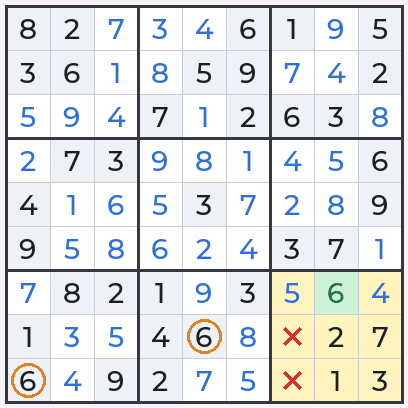

<!-- Written by tools/walkthrough.py quadro: edit the script, not this page. -->
# Quadro, step 42: the 6 in box 9

**Step 42 of 44** · [← Step 41](step-41.md) · [All steps](../quadro.md#the-whole-puzzle-step-by-step) · [Step 43 →](step-43.md)

Box 9 needs a 6. r8c7: row 8 has one (r8c5). r9c7: row 9 has one (r9c1). Only **r7c8** is left: **r7c8 = 6**.

**Step 42 of 44** · [← Step 41](step-41.md) · [All steps](../quadro.md#the-whole-puzzle-step-by-step) · [Step 43 →](step-43.md)
