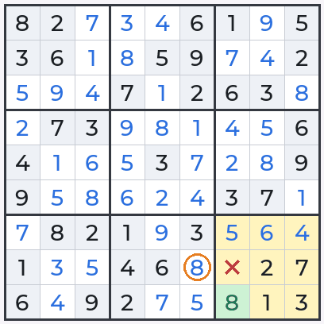

<!-- Written by tools/walkthrough.py quadro: edit the script, not this page. -->
# Quadro, step 43: the 8 in box 9

**Step 43 of 44** · [← Step 42](step-42.md) · [All steps](../quadro.md#the-whole-puzzle-step-by-step) · [Step 44 →](step-44.md)

Box 9 needs an 8. r8c7: row 8 has one (r8c6). Only **r9c7** is left: **r9c7 = 8**.

**Step 43 of 44** · [← Step 42](step-42.md) · [All steps](../quadro.md#the-whole-puzzle-step-by-step) · [Step 44 →](step-44.md)
