# Quadruple

[← All variants](README.md) · [Puzzles](../features-puzzles.md) · [How to play](../how-to-play.md)

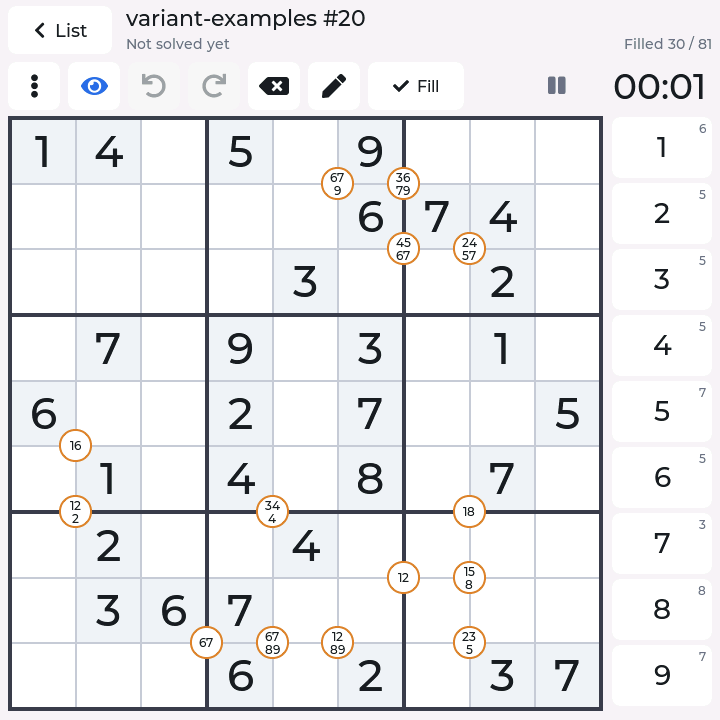

## The rules

[Classic](classic.md) rules, and **circles** where four cells meet, each listing **1 to 4 digits that must be among those four cells**, in any order. The other cells around the circle can hold anything else. A digit can be listed twice: then it's in two of the four cells, corner to corner (side by side would put it twice in a row or column).

## On the board

- Each circle sits on the corner where its four cells meet, with its digits inside, two to a line.
- When a circle's empty cells are fewer than the digits it still misses, its cells turn red.
- The grader and hints know two steps: when a circle's missing digits exactly fill its empty cells, those cells take nothing else; and a missing digit with only as many places as it needs takes them. "The circle with 139 needs those digits among its four cells, which leaves row 2, column 5 only 3, 9".
- **Puzzles → ⋮ → New puzzle → Quadruple**: 14 circles (Hard and Expert 18).

## How to solve it

- **Count:** compare a circle's missing digits with its empty cells. Equal numbers mean every empty cell takes one of those digits, and nothing else.
- **A full circle with one gap:** if three of four listed digits are placed, the fourth goes in the last empty cell.
- **Where can a listed digit go?** Within the four cells, rule out the ones whose row, column or box already has it. If one cell is left, it's there.
- A circle also says what's *not* there: a circle of four digits fixes the whole set of its four cells.

## Worked example

**variant-examples #20**, Quadruple Easy (see [Classic](classic.md#worked-example) for how to import the examples; cells are written r*row*c*column*). The circles are in the screenshot; two matter here:

- **1 2 8 9** where r8c5, r8c6, r9c5 and r9c6 meet (r9c6 is a given 2);
- **3 6 7 9** where r1c6, r1c7, r2c6 and r2c7 meet (r1c6 is 9, r2c6 is 6, r2c7 is 7).

```
1 4 . | 5 . 9 | . . .
. . . | . . 6 | 7 4 .
. . . | . 3 . | . 2 .
------+-------+------
. 7 . | 9 . 3 | . 1 .
6 . . | 2 . 7 | . . 5
. 1 . | 4 . 8 | . 7 .
------+-------+------
. 2 . | . 4 . | . . .
. 3 6 | 7 . . | . . .
. . . | 6 . 2 | . 3 7
```

**Step 1: r8c6, in the 1-2-8-9 circle.** Row 8 has 3, 6 and 7; column 6 has 9, 6, 3, 7, 8 and 2; box 8 has 4, 7, 6 and 2. By the Classic rules r8c6 could be 1 or 5. Now the circle: its 2 is placed (r9c6), so 1, 8 and 9 are still missing, and it has exactly three empty cells (r8c5, r8c6, r9c5). Each of them must take one of 1, 8 and 9: r8c6 can't be 5. **r8c6 = 1**.

**Step 2: r1c7, the last gap in the 3-6-7-9 circle.** The circle's 9 (r1c6), 6 (r2c6) and 7 (r2c7) are placed; its 3 must be in its one empty cell. **r1c7 = 3**.

**Step 3: the 6 in box 1.** Box 1 (top left) needs a 6. Column 3 has one (r8c3), row 2 too (r2c6) and column 1 (r5c1): that rules out r1c3, r3c3, r2c1, r2c2, r2c3 and r3c1. **r3c2 = 6**.

Back at the 1-2-8-9 circle: with the 1 in r8c6, its other two empty cells, r8c5 and r9c5, now hold 8 and 9 between them. Which is which comes later, from row 8, row 9 or column 5.

## The whole puzzle, step by step

<!-- walkthrough -->
<!-- Written by tools/walkthrough.py quadruple: edit the script, not this part. -->

The whole puzzle, from the start to the last cell: 51 steps, each one a single (one place left for a digit, or one digit left for a cell), taken in the order a box's single comes first, so not quite the order of the worked example above. In each picture, the unit the step looks at is tinted yellow (for a cell with one digit left: its row, column and box), the new digit is on green, the digits that rule cells out have an **orange ring**, and the empty cells they rule out a **red cross**. Givens are on grey, digits from earlier steps in blue.

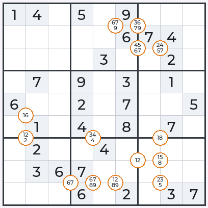

#### Step 1: the 6 in box 1

Box 1 needs a 6. r1c3 and r3c3: column 3 has one (r8c3). r2c1, r2c2 and r2c3: row 2 has one (r2c6). r3c1: column 1 has one (r5c1). Only **r3c2** is left: **r3c2 = 6**.

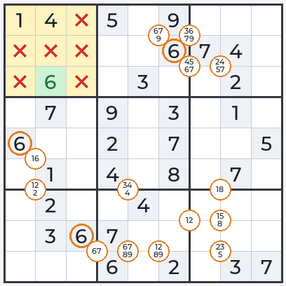

#### Step 2: the 4 in box 2

Box 2 needs a 4. r1c5: row 1 has one (r1c2). r2c4 and r2c5: row 2 has one (r2c8). r3c4: column 4 has one (r6c4). Only **r3c6** is left: **r3c6 = 4**.

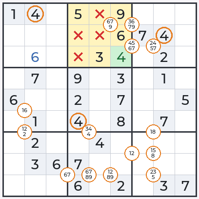

#### Step 3: the 7 in box 2

Box 2 needs a 7. r2c4 and r2c5: row 2 has one (r2c7). r3c4: column 4 has one (r8c4). Only **r1c5** is left: **r1c5 = 7**.

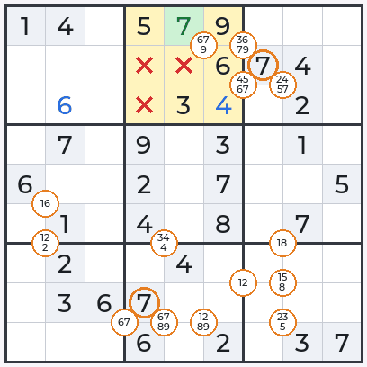

#### Step 4: the 2 in box 2

Box 2 needs a 2. r2c4: column 4 has one (r5c4). r3c4: row 3 has one (r3c8). Only **r2c5** is left: **r2c5 = 2**.

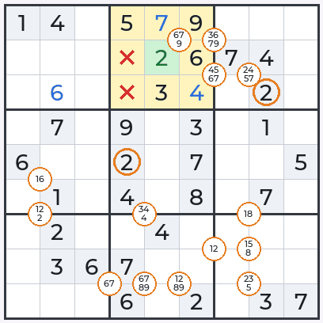

#### Step 5: the 2 in box 1

Box 1 needs a 2. r2c1, r2c2 and r2c3: row 2 has one (r2c5). r3c1 and r3c3: row 3 has one (r3c8). Only **r1c3** is left: **r1c3 = 2**.

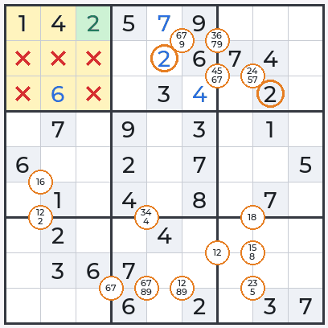

#### Step 6: the 5 in box 3

Box 3 needs a 5. r1c7, r1c8 and r1c9: row 1 has one (r1c4). r2c9 and r3c9: column 9 has one (r5c9). Only **r3c7** is left: **r3c7 = 5**.

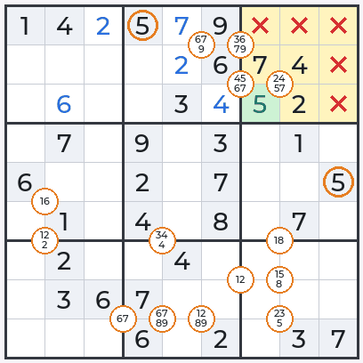

#### Step 7: the 1 in box 5

Box 5 needs a 1. r4c5: row 4 has one (r4c8). r6c5: row 6 has one (r6c2). Only **r5c5** is left: **r5c5 = 1**.

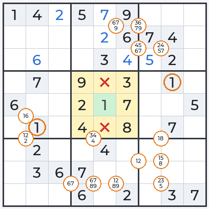

#### Step 8: the 3 in box 8

Box 8 needs a 3. r7c6: column 6 has one (r4c6). r8c5 and r8c6: row 8 has one (r8c2). r9c5: row 9 has one (r9c8). Only **r7c4** is left: **r7c4 = 3**.

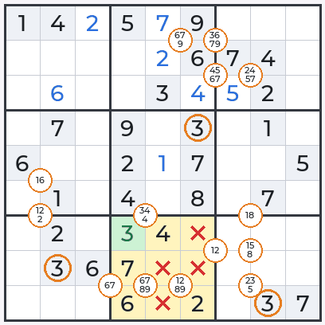

#### Step 9: the 5 in box 8

Box 8 needs a 5. r8c5, r8c6 and r9c5: the circle 1289 still needs 1, 8 and 9 in its 3 empty cells, so they take nothing else. Only **r7c6** is left: **r7c6 = 5**.

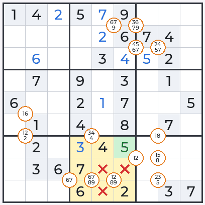

#### Step 10: the 1 in box 8

Box 8 needs a 1. r8c5 and r9c5: column 5 has one (r5c5). Only **r8c6** is left: **r8c6 = 1**.

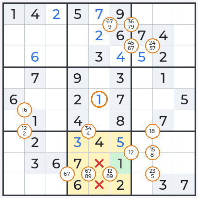

#### Step 11: the 5 in box 9

Box 9 needs a 5. r7c7, r7c8 and r7c9: row 7 has one (r7c6). r8c7 and r9c7: column 7 has one (r3c7). r8c9: column 9 has one (r5c9). Only **r8c8** is left: **r8c8 = 5**.

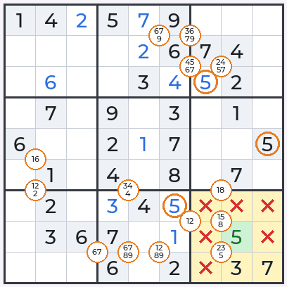

#### Step 12: r1c7

Row 1 has 1, 2, 4, 5, 7 and 9. Not 6 or 8: the circle 3679 still needs 3 in its one empty cell. Only 3 is left: **r1c7 = 3**.

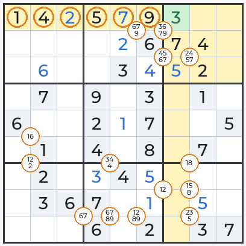

#### Step 13: the 3 in box 6

Box 6 needs a 3. r4c7 and r4c9: row 4 has one (r4c6). r5c7 and r6c7: column 7 has one (r1c7). r5c8: column 8 has one (r9c8). Only **r6c9** is left: **r6c9 = 3**.

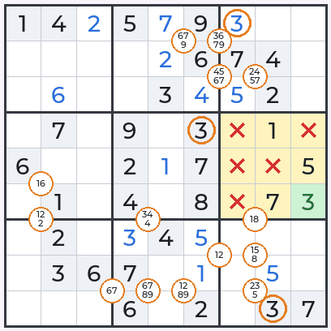

#### Step 14: the 3 in box 4

Box 4 needs a 3. r4c1 and r4c3: row 4 has one (r4c6). r5c2: column 2 has one (r8c2). r6c1 and r6c3: row 6 has one (r6c9). Only **r5c3** is left: **r5c3 = 3**.

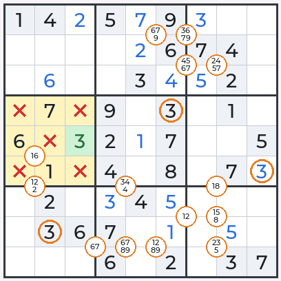

#### Step 15: the 3 in box 1

Box 1 needs a 3. r2c2: column 2 has one (r8c2). r2c3: column 3 has one (r5c3). r3c1 and r3c3: row 3 has one (r3c5). Only **r2c1** is left: **r2c1 = 3**.

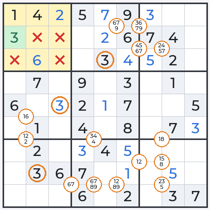

#### Step 16: the 4 in row 5

Row 5 needs a 4. r5c2: column 2 has one (r1c2). r5c8: column 8 has one (r2c8). Only **r5c7** is left: **r5c7 = 4**.

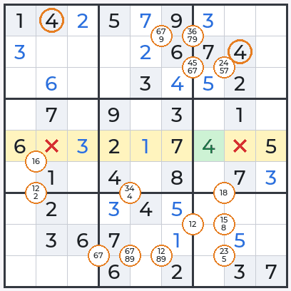

#### Step 17: the 4 in box 9

Box 9 needs a 4. r7c7, r7c8 and r7c9: row 7 has one (r7c5). r8c7 and r9c7: column 7 has one (r5c7). Only **r8c9** is left: **r8c9 = 4**.

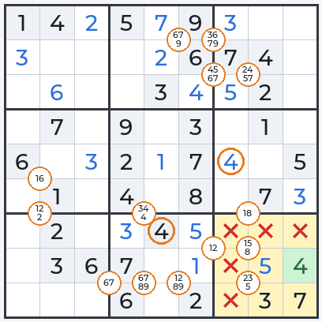

#### Step 18: the 2 in box 9

Box 9 needs a 2. r7c7, r7c8 and r7c9: row 7 has one (r7c2). r9c7: row 9 has one (r9c6). Only **r8c7** is left: **r8c7 = 2**.

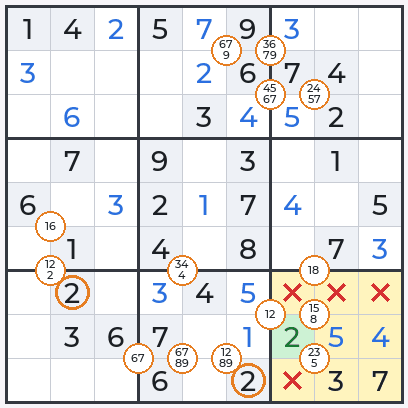

#### Step 19: the 2 in box 6

Box 6 needs a 2. r4c7 and r6c7: column 7 has one (r8c7). r5c8: row 5 has one (r5c4). Only **r4c9** is left: **r4c9 = 2**.

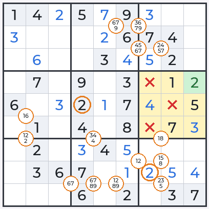

#### Step 20: the 2 in box 4

Box 4 needs a 2. r4c1 and r4c3: row 4 has one (r4c9). r5c2: row 5 has one (r5c4). r6c3: column 3 has one (r1c3). Only **r6c1** is left: **r6c1 = 2**.

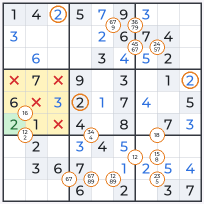

#### Step 21: the 6 in box 9

Box 9 needs a 6. r9c7: row 9 has one (r9c4). r7c7 and r7c8: the circle 158 still needs 1 and 8 in its 2 empty cells, so they take nothing else. Only **r7c9** is left: **r7c9 = 6**.

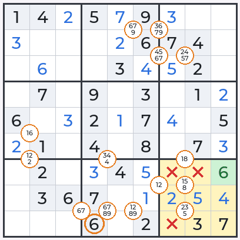

#### Step 22: the 6 in box 3

Box 3 needs a 6. r1c9: column 9 has one (r7c9). r2c9: row 2 has one (r2c6). r3c9: row 3 has one (r3c2). Only **r1c8** is left: **r1c8 = 6**.

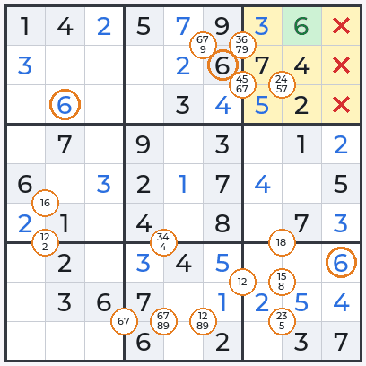

#### Step 23: the 9 in box 9

Box 9 needs a 9. r7c7 and r7c8: the circle 158 still needs 1 and 8 in its 2 empty cells, so they take nothing else. Only **r9c7** is left: **r9c7 = 9**.

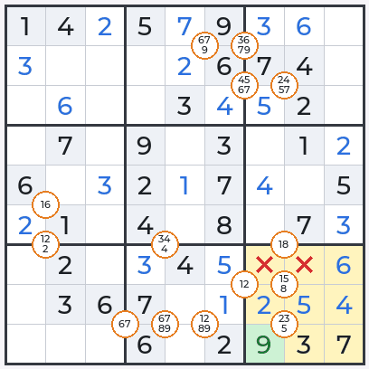

#### Step 24: the 9 in box 6

Box 6 needs a 9. r4c7: row 4 has one (r4c4). r6c7: column 7 has one (r9c7). Only **r5c8** is left: **r5c8 = 9**.

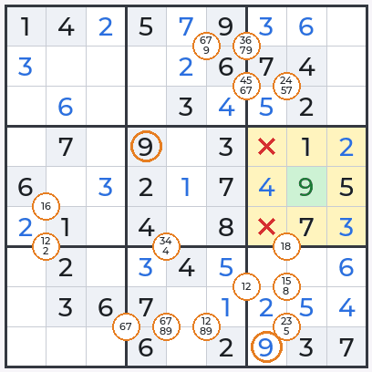

#### Step 25: the 9 in box 4

Box 4 needs a 9. r4c1 and r4c3: row 4 has one (r4c4). r5c2: row 5 has one (r5c8). Only **r6c3** is left: **r6c3 = 9**.

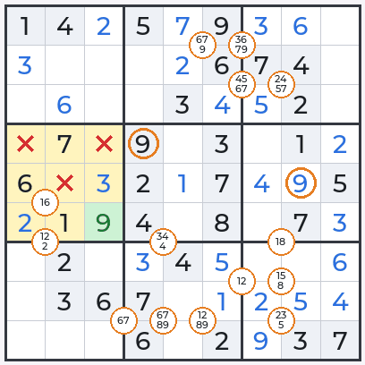

#### Step 26: the 8 in box 6

Box 6 needs an 8. r6c7: row 6 has one (r6c6). Only **r4c7** is left: **r4c7 = 8**.

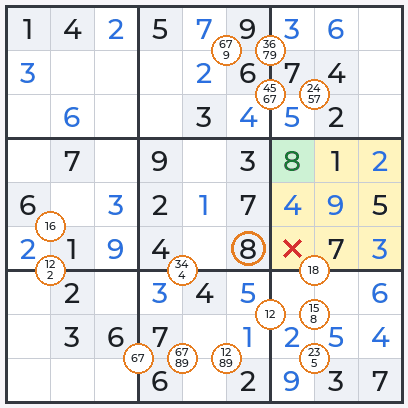

#### Step 27: the 8 in box 4

Box 4 needs an 8. r4c1 and r4c3: row 4 has one (r4c7). Only **r5c2** is left: **r5c2 = 8**.

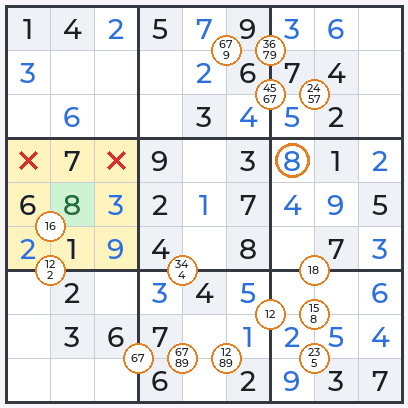

#### Step 28: the 6 in box 6

Box 6 needs a 6, and r6c7 is its last empty cell: **r6c7 = 6**.

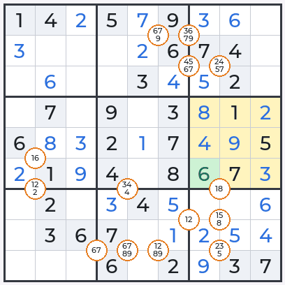

#### Step 29: the 6 in box 5

Box 5 needs a 6. r6c5: row 6 has one (r6c7). Only **r4c5** is left: **r4c5 = 6**.

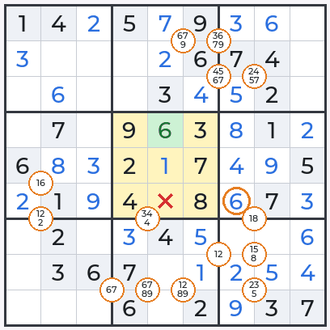

#### Step 30: the 5 in box 5

Box 5 needs a 5, and r6c5 is its last empty cell: **r6c5 = 5**.

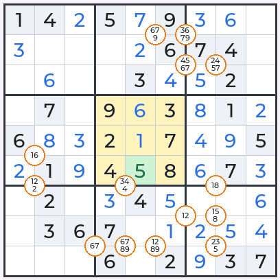

#### Step 31: the 9 in box 8

Box 8 needs a 9. r9c5: row 9 has one (r9c7). Only **r8c5** is left: **r8c5 = 9**.

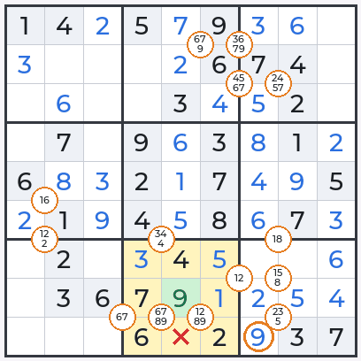

#### Step 32: the 9 in box 7

Box 7 needs a 9. r7c3: column 3 has one (r6c3). r8c1: row 8 has one (r8c5). r9c1, r9c2 and r9c3: row 9 has one (r9c7). Only **r7c1** is left: **r7c1 = 9**.

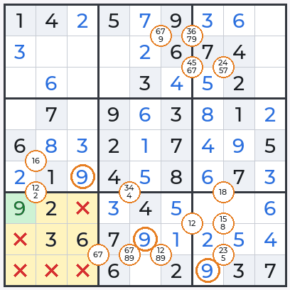

#### Step 33: the 9 in box 1

Box 1 needs a 9. r2c3 and r3c3: column 3 has one (r6c3). r3c1: column 1 has one (r7c1). Only **r2c2** is left: **r2c2 = 9**.

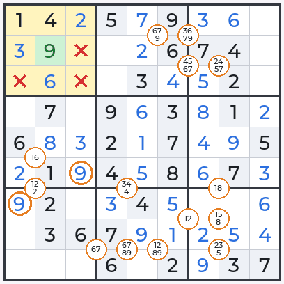

#### Step 34: the 5 in box 1

Box 1 needs a 5. r3c1 and r3c3: row 3 has one (r3c7). Only **r2c3** is left: **r2c3 = 5**.

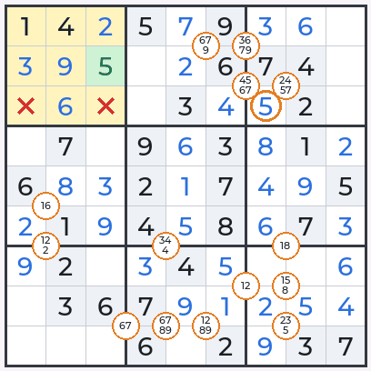

#### Step 35: the 9 in box 3

Box 3 needs a 9. r1c9: row 1 has one (r1c6). r2c9: row 2 has one (r2c2). Only **r3c9** is left: **r3c9 = 9**.

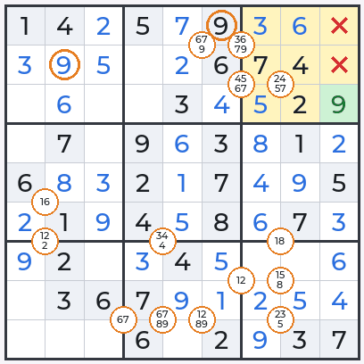

#### Step 36: the 1 in box 3

Box 3 needs a 1. r1c9: row 1 has one (r1c1). Only **r2c9** is left: **r2c9 = 1**.

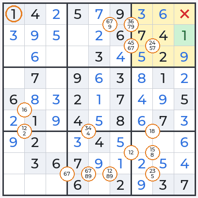

#### Step 37: the 1 in box 2

Box 2 needs a 1. r2c4: row 2 has one (r2c9). Only **r3c4** is left: **r3c4 = 1**.

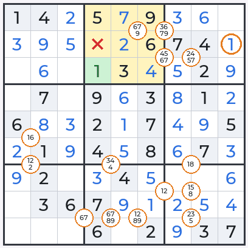

#### Step 38: the 8 in box 2

Box 2 needs an 8, and r2c4 is its last empty cell: **r2c4 = 8**.

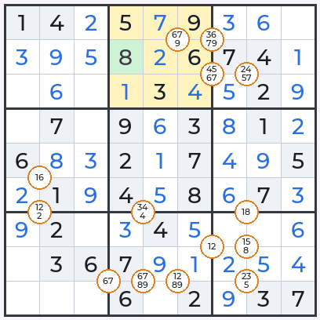

#### Step 39: the 8 in box 3

Box 3 needs an 8, and r1c9 is its last empty cell: **r1c9 = 8**.

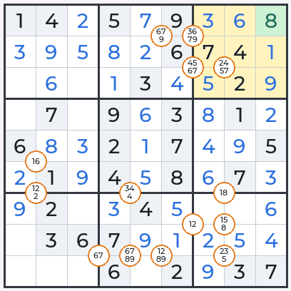

#### Step 40: the 5 in box 4

Box 4 needs a 5. r4c3: column 3 has one (r2c3). Only **r4c1** is left: **r4c1 = 5**.

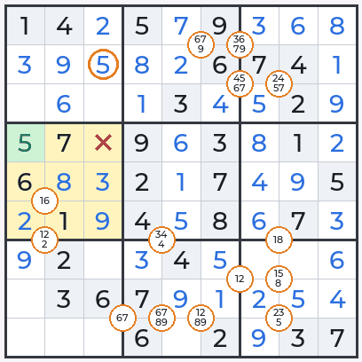

#### Step 41: the 4 in box 4

Box 4 needs a 4, and r4c3 is its last empty cell: **r4c3 = 4**.

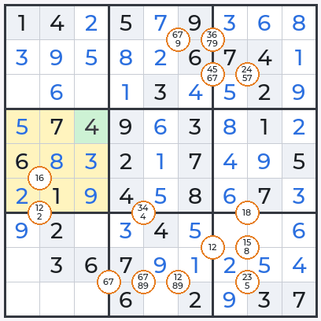

#### Step 42: the 4 in box 7

Box 7 needs a 4. r7c3: row 7 has one (r7c5). r8c1: row 8 has one (r8c9). r9c2: column 2 has one (r1c2). r9c3: column 3 has one (r4c3). Only **r9c1** is left: **r9c1 = 4**.

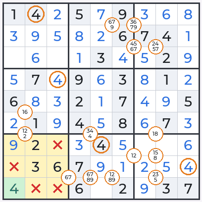

#### Step 43: the 5 in box 7

Box 7 needs a 5. r7c3: row 7 has one (r7c6). r8c1: row 8 has one (r8c8). r9c3: column 3 has one (r2c3). Only **r9c2** is left: **r9c2 = 5**.

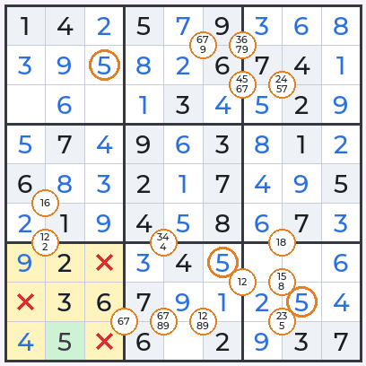

#### Step 44: the 7 in box 7

Box 7 needs a 7. r8c1: row 8 has one (r8c4). r9c3: row 9 has one (r9c9). Only **r7c3** is left: **r7c3 = 7**.

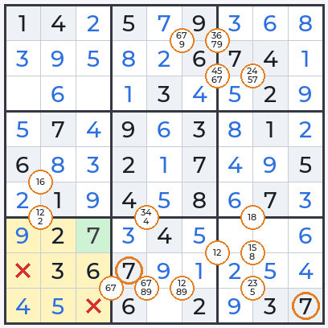

#### Step 45: the 7 in box 1

Box 1 needs a 7. r3c3: column 3 has one (r7c3). Only **r3c1** is left: **r3c1 = 7**.

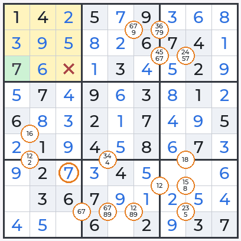

#### Step 46: the 8 in box 1

Box 1 needs an 8, and r3c3 is its last empty cell: **r3c3 = 8**.

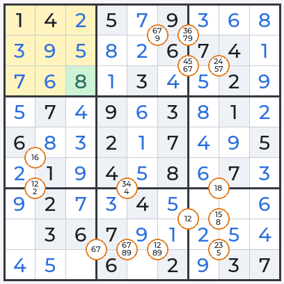

#### Step 47: the 1 in box 7

Box 7 needs a 1. r8c1: row 8 has one (r8c6). Only **r9c3** is left: **r9c3 = 1**.

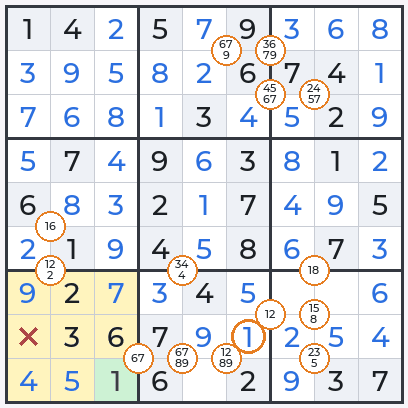

#### Step 48: the 8 in box 7

Box 7 needs an 8, and r8c1 is its last empty cell: **r8c1 = 8**.

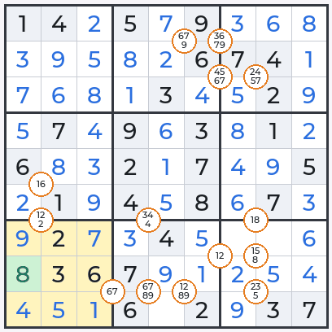

#### Step 49: the 8 in box 8

Box 8 needs an 8, and r9c5 is its last empty cell: **r9c5 = 8**.


#### Step 50: the 1 in box 9

Box 9 needs a 1. r7c8: column 8 has one (r4c8). Only **r7c7** is left: **r7c7 = 1**.


#### Step 51: the 8 in box 9

Box 9 needs an 8, and r7c8 is its last empty cell: **r7c8 = 8**.


Solved.

<!-- /walkthrough -->
