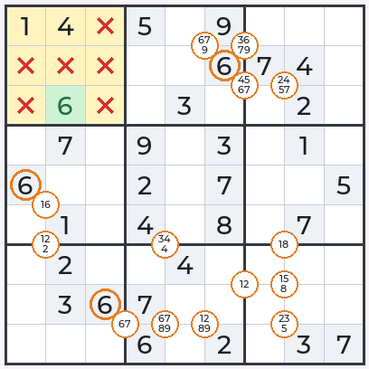

<!-- Written by tools/walkthrough.py quadruple: edit the script, not this page. -->
# Quadruple, step 1: the 6 in box 1

**Step 1 of 51** · [← The start](../quadruple.md#the-whole-puzzle-step-by-step) · [All steps](../quadruple.md#the-whole-puzzle-step-by-step) · [Step 2 →](step-02.md)

Box 1 needs a 6. r1c3 and r3c3: column 3 has one (r8c3). r2c1, r2c2 and r2c3: row 2 has one (r2c6). r3c1: column 1 has one (r5c1). Only **r3c2** is left: **r3c2 = 6**.

**Step 1 of 51** · [← The start](../quadruple.md#the-whole-puzzle-step-by-step) · [All steps](../quadruple.md#the-whole-puzzle-step-by-step) · [Step 2 →](step-02.md)
