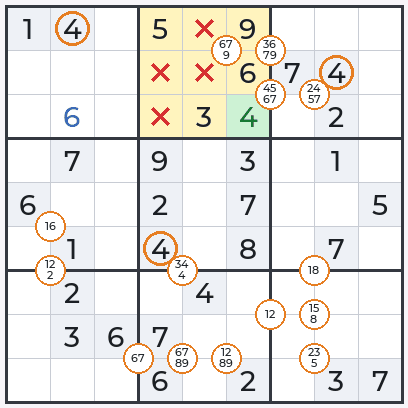

<!-- Written by tools/walkthrough.py quadruple: edit the script, not this page. -->
# Quadruple, step 2: the 4 in box 2

**Step 2 of 51** · [← Step 1](step-01.md) · [All steps](../quadruple.md#the-whole-puzzle-step-by-step) · [Step 3 →](step-03.md)

Box 2 needs a 4. r1c5: row 1 has one (r1c2). r2c4 and r2c5: row 2 has one (r2c8). r3c4: column 4 has one (r6c4). Only **r3c6** is left: **r3c6 = 4**.

**Step 2 of 51** · [← Step 1](step-01.md) · [All steps](../quadruple.md#the-whole-puzzle-step-by-step) · [Step 3 →](step-03.md)
