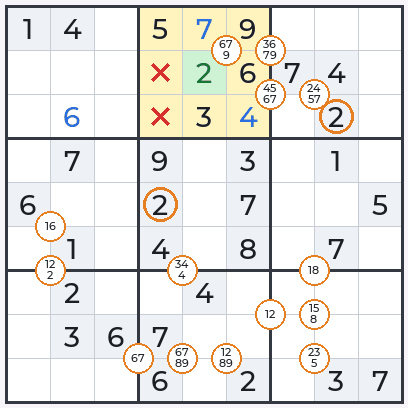

<!-- Written by tools/walkthrough.py quadruple: edit the script, not this page. -->
# Quadruple, step 4: the 2 in box 2

**Step 4 of 51** · [← Step 3](step-03.md) · [All steps](../quadruple.md#the-whole-puzzle-step-by-step) · [Step 5 →](step-05.md)

Box 2 needs a 2. r2c4: column 4 has one (r5c4). r3c4: row 3 has one (r3c8). Only **r2c5** is left: **r2c5 = 2**.

**Step 4 of 51** · [← Step 3](step-03.md) · [All steps](../quadruple.md#the-whole-puzzle-step-by-step) · [Step 5 →](step-05.md)
