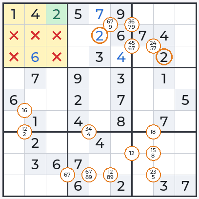

<!-- Written by tools/walkthrough.py quadruple: edit the script, not this page. -->
# Quadruple, step 5: the 2 in box 1

**Step 5 of 51** · [← Step 4](step-04.md) · [All steps](../quadruple.md#the-whole-puzzle-step-by-step) · [Step 6 →](step-06.md)

Box 1 needs a 2. r2c1, r2c2 and r2c3: row 2 has one (r2c5). r3c1 and r3c3: row 3 has one (r3c8). Only **r1c3** is left: **r1c3 = 2**.

**Step 5 of 51** · [← Step 4](step-04.md) · [All steps](../quadruple.md#the-whole-puzzle-step-by-step) · [Step 6 →](step-06.md)
