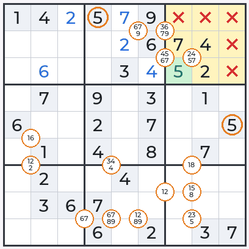

<!-- Written by tools/walkthrough.py quadruple: edit the script, not this page. -->
# Quadruple, step 6: the 5 in box 3

**Step 6 of 51** · [← Step 5](step-05.md) · [All steps](../quadruple.md#the-whole-puzzle-step-by-step) · [Step 7 →](step-07.md)

Box 3 needs a 5. r1c7, r1c8 and r1c9: row 1 has one (r1c4). r2c9 and r3c9: column 9 has one (r5c9). Only **r3c7** is left: **r3c7 = 5**.

**Step 6 of 51** · [← Step 5](step-05.md) · [All steps](../quadruple.md#the-whole-puzzle-step-by-step) · [Step 7 →](step-07.md)
