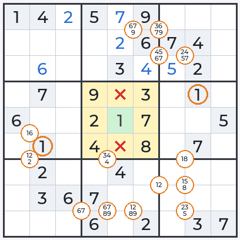

<!-- Written by tools/walkthrough.py quadruple: edit the script, not this page. -->
# Quadruple, step 7: the 1 in box 5

**Step 7 of 51** · [← Step 6](step-06.md) · [All steps](../quadruple.md#the-whole-puzzle-step-by-step) · [Step 8 →](step-08.md)

Box 5 needs a 1. r4c5: row 4 has one (r4c8). r6c5: row 6 has one (r6c2). Only **r5c5** is left: **r5c5 = 1**.

**Step 7 of 51** · [← Step 6](step-06.md) · [All steps](../quadruple.md#the-whole-puzzle-step-by-step) · [Step 8 →](step-08.md)
