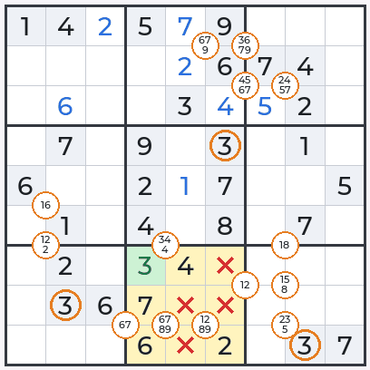

<!-- Written by tools/walkthrough.py quadruple: edit the script, not this page. -->
# Quadruple, step 8: the 3 in box 8

**Step 8 of 51** · [← Step 7](step-07.md) · [All steps](../quadruple.md#the-whole-puzzle-step-by-step) · [Step 9 →](step-09.md)

Box 8 needs a 3. r7c6: column 6 has one (r4c6). r8c5 and r8c6: row 8 has one (r8c2). r9c5: row 9 has one (r9c8). Only **r7c4** is left: **r7c4 = 3**.

**Step 8 of 51** · [← Step 7](step-07.md) · [All steps](../quadruple.md#the-whole-puzzle-step-by-step) · [Step 9 →](step-09.md)
