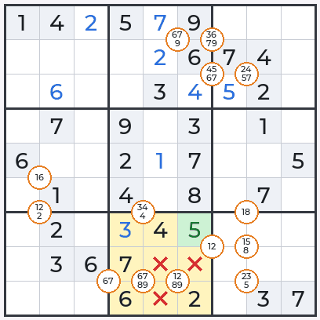

<!-- Written by tools/walkthrough.py quadruple: edit the script, not this page. -->
# Quadruple, step 9: the 5 in box 8

**Step 9 of 51** · [← Step 8](step-08.md) · [All steps](../quadruple.md#the-whole-puzzle-step-by-step) · [Step 10 →](step-10.md)

Box 8 needs a 5. r8c5, r8c6 and r9c5: the circle 1289 still needs 1, 8 and 9 in its 3 empty cells, so they take nothing else. Only **r7c6** is left: **r7c6 = 5**.

**Step 9 of 51** · [← Step 8](step-08.md) · [All steps](../quadruple.md#the-whole-puzzle-step-by-step) · [Step 10 →](step-10.md)
