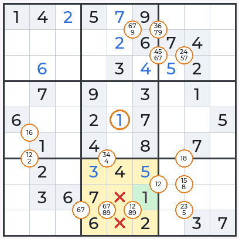

<!-- Written by tools/walkthrough.py quadruple: edit the script, not this page. -->
# Quadruple, step 10: the 1 in box 8

**Step 10 of 51** · [← Step 9](step-09.md) · [All steps](../quadruple.md#the-whole-puzzle-step-by-step) · [Step 11 →](step-11.md)

Box 8 needs a 1. r8c5 and r9c5: column 5 has one (r5c5). Only **r8c6** is left: **r8c6 = 1**.

**Step 10 of 51** · [← Step 9](step-09.md) · [All steps](../quadruple.md#the-whole-puzzle-step-by-step) · [Step 11 →](step-11.md)
