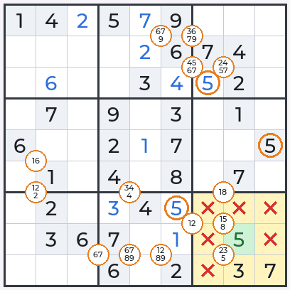

<!-- Written by tools/walkthrough.py quadruple: edit the script, not this page. -->
# Quadruple, step 11: the 5 in box 9

**Step 11 of 51** · [← Step 10](step-10.md) · [All steps](../quadruple.md#the-whole-puzzle-step-by-step) · [Step 12 →](step-12.md)

Box 9 needs a 5. r7c7, r7c8 and r7c9: row 7 has one (r7c6). r8c7 and r9c7: column 7 has one (r3c7). r8c9: column 9 has one (r5c9). Only **r8c8** is left: **r8c8 = 5**.

**Step 11 of 51** · [← Step 10](step-10.md) · [All steps](../quadruple.md#the-whole-puzzle-step-by-step) · [Step 12 →](step-12.md)
