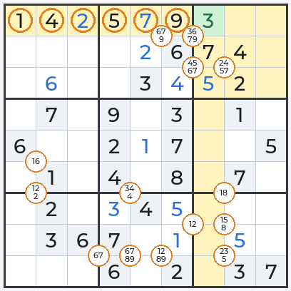

<!-- Written by tools/walkthrough.py quadruple: edit the script, not this page. -->
# Quadruple, step 12: r1c7

**Step 12 of 51** · [← Step 11](step-11.md) · [All steps](../quadruple.md#the-whole-puzzle-step-by-step) · [Step 13 →](step-13.md)

Row 1 has 1, 2, 4, 5, 7 and 9. Not 6 or 8: the circle 3679 still needs 3 in its one empty cell. Only 3 is left: **r1c7 = 3**.

**Step 12 of 51** · [← Step 11](step-11.md) · [All steps](../quadruple.md#the-whole-puzzle-step-by-step) · [Step 13 →](step-13.md)
