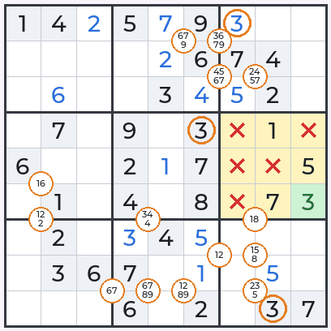

<!-- Written by tools/walkthrough.py quadruple: edit the script, not this page. -->
# Quadruple, step 13: the 3 in box 6

**Step 13 of 51** · [← Step 12](step-12.md) · [All steps](../quadruple.md#the-whole-puzzle-step-by-step) · [Step 14 →](step-14.md)

Box 6 needs a 3. r4c7 and r4c9: row 4 has one (r4c6). r5c7 and r6c7: column 7 has one (r1c7). r5c8: column 8 has one (r9c8). Only **r6c9** is left: **r6c9 = 3**.

**Step 13 of 51** · [← Step 12](step-12.md) · [All steps](../quadruple.md#the-whole-puzzle-step-by-step) · [Step 14 →](step-14.md)
