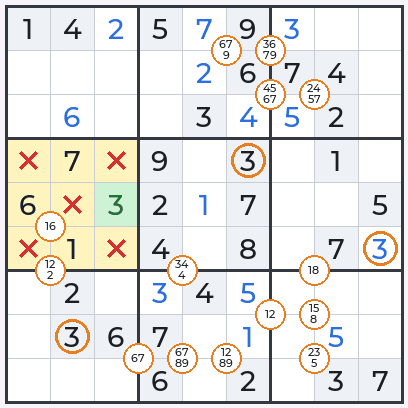

<!-- Written by tools/walkthrough.py quadruple: edit the script, not this page. -->
# Quadruple, step 14: the 3 in box 4

**Step 14 of 51** · [← Step 13](step-13.md) · [All steps](../quadruple.md#the-whole-puzzle-step-by-step) · [Step 15 →](step-15.md)

Box 4 needs a 3. r4c1 and r4c3: row 4 has one (r4c6). r5c2: column 2 has one (r8c2). r6c1 and r6c3: row 6 has one (r6c9). Only **r5c3** is left: **r5c3 = 3**.

**Step 14 of 51** · [← Step 13](step-13.md) · [All steps](../quadruple.md#the-whole-puzzle-step-by-step) · [Step 15 →](step-15.md)
