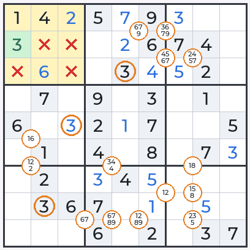

<!-- Written by tools/walkthrough.py quadruple: edit the script, not this page. -->
# Quadruple, step 15: the 3 in box 1

**Step 15 of 51** · [← Step 14](step-14.md) · [All steps](../quadruple.md#the-whole-puzzle-step-by-step) · [Step 16 →](step-16.md)

Box 1 needs a 3. r2c2: column 2 has one (r8c2). r2c3: column 3 has one (r5c3). r3c1 and r3c3: row 3 has one (r3c5). Only **r2c1** is left: **r2c1 = 3**.

**Step 15 of 51** · [← Step 14](step-14.md) · [All steps](../quadruple.md#the-whole-puzzle-step-by-step) · [Step 16 →](step-16.md)
