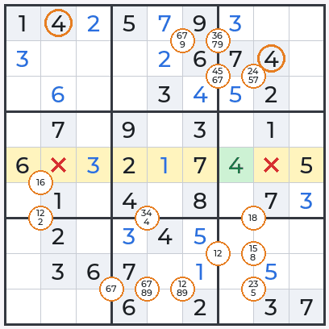

<!-- Written by tools/walkthrough.py quadruple: edit the script, not this page. -->
# Quadruple, step 16: the 4 in row 5

**Step 16 of 51** · [← Step 15](step-15.md) · [All steps](../quadruple.md#the-whole-puzzle-step-by-step) · [Step 17 →](step-17.md)

Row 5 needs a 4. r5c2: column 2 has one (r1c2). r5c8: column 8 has one (r2c8). Only **r5c7** is left: **r5c7 = 4**.

**Step 16 of 51** · [← Step 15](step-15.md) · [All steps](../quadruple.md#the-whole-puzzle-step-by-step) · [Step 17 →](step-17.md)
