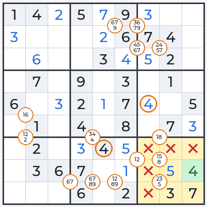

<!-- Written by tools/walkthrough.py quadruple: edit the script, not this page. -->
# Quadruple, step 17: the 4 in box 9

**Step 17 of 51** · [← Step 16](step-16.md) · [All steps](../quadruple.md#the-whole-puzzle-step-by-step) · [Step 18 →](step-18.md)

Box 9 needs a 4. r7c7, r7c8 and r7c9: row 7 has one (r7c5). r8c7 and r9c7: column 7 has one (r5c7). Only **r8c9** is left: **r8c9 = 4**.

**Step 17 of 51** · [← Step 16](step-16.md) · [All steps](../quadruple.md#the-whole-puzzle-step-by-step) · [Step 18 →](step-18.md)
