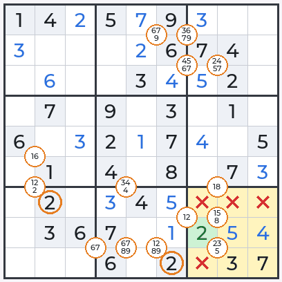

<!-- Written by tools/walkthrough.py quadruple: edit the script, not this page. -->
# Quadruple, step 18: the 2 in box 9

**Step 18 of 51** · [← Step 17](step-17.md) · [All steps](../quadruple.md#the-whole-puzzle-step-by-step) · [Step 19 →](step-19.md)

Box 9 needs a 2. r7c7, r7c8 and r7c9: row 7 has one (r7c2). r9c7: row 9 has one (r9c6). Only **r8c7** is left: **r8c7 = 2**.

**Step 18 of 51** · [← Step 17](step-17.md) · [All steps](../quadruple.md#the-whole-puzzle-step-by-step) · [Step 19 →](step-19.md)
