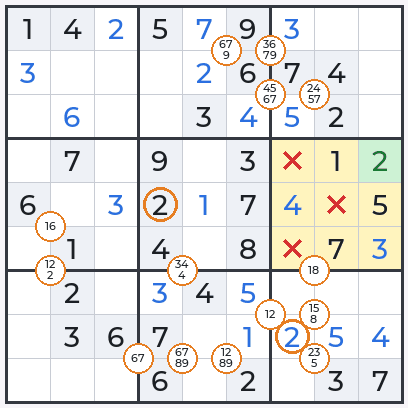

<!-- Written by tools/walkthrough.py quadruple: edit the script, not this page. -->
# Quadruple, step 19: the 2 in box 6

**Step 19 of 51** · [← Step 18](step-18.md) · [All steps](../quadruple.md#the-whole-puzzle-step-by-step) · [Step 20 →](step-20.md)

Box 6 needs a 2. r4c7 and r6c7: column 7 has one (r8c7). r5c8: row 5 has one (r5c4). Only **r4c9** is left: **r4c9 = 2**.

**Step 19 of 51** · [← Step 18](step-18.md) · [All steps](../quadruple.md#the-whole-puzzle-step-by-step) · [Step 20 →](step-20.md)
