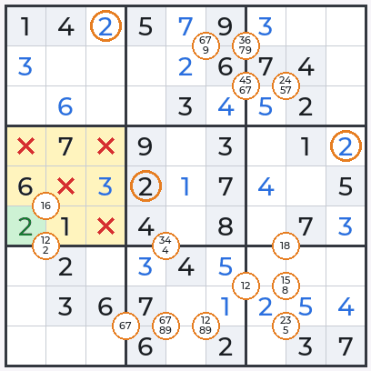

<!-- Written by tools/walkthrough.py quadruple: edit the script, not this page. -->
# Quadruple, step 20: the 2 in box 4

**Step 20 of 51** · [← Step 19](step-19.md) · [All steps](../quadruple.md#the-whole-puzzle-step-by-step) · [Step 21 →](step-21.md)

Box 4 needs a 2. r4c1 and r4c3: row 4 has one (r4c9). r5c2: row 5 has one (r5c4). r6c3: column 3 has one (r1c3). Only **r6c1** is left: **r6c1 = 2**.

**Step 20 of 51** · [← Step 19](step-19.md) · [All steps](../quadruple.md#the-whole-puzzle-step-by-step) · [Step 21 →](step-21.md)
