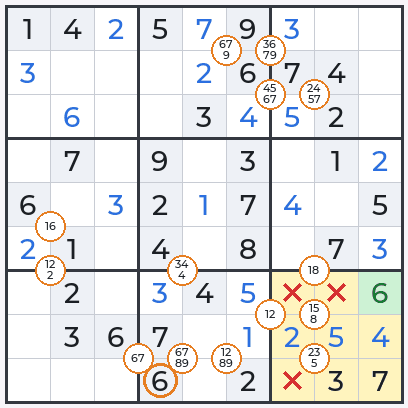

<!-- Written by tools/walkthrough.py quadruple: edit the script, not this page. -->
# Quadruple, step 21: the 6 in box 9

**Step 21 of 51** · [← Step 20](step-20.md) · [All steps](../quadruple.md#the-whole-puzzle-step-by-step) · [Step 22 →](step-22.md)

Box 9 needs a 6. r9c7: row 9 has one (r9c4). r7c7 and r7c8: the circle 158 still needs 1 and 8 in its 2 empty cells, so they take nothing else. Only **r7c9** is left: **r7c9 = 6**.

**Step 21 of 51** · [← Step 20](step-20.md) · [All steps](../quadruple.md#the-whole-puzzle-step-by-step) · [Step 22 →](step-22.md)
