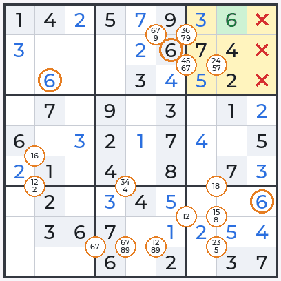

<!-- Written by tools/walkthrough.py quadruple: edit the script, not this page. -->
# Quadruple, step 22: the 6 in box 3

**Step 22 of 51** · [← Step 21](step-21.md) · [All steps](../quadruple.md#the-whole-puzzle-step-by-step) · [Step 23 →](step-23.md)

Box 3 needs a 6. r1c9: column 9 has one (r7c9). r2c9: row 2 has one (r2c6). r3c9: row 3 has one (r3c2). Only **r1c8** is left: **r1c8 = 6**.

**Step 22 of 51** · [← Step 21](step-21.md) · [All steps](../quadruple.md#the-whole-puzzle-step-by-step) · [Step 23 →](step-23.md)
