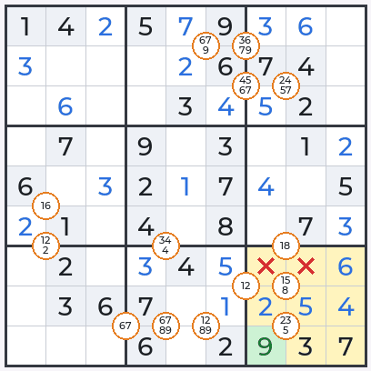

<!-- Written by tools/walkthrough.py quadruple: edit the script, not this page. -->
# Quadruple, step 23: the 9 in box 9

**Step 23 of 51** · [← Step 22](step-22.md) · [All steps](../quadruple.md#the-whole-puzzle-step-by-step) · [Step 24 →](step-24.md)

Box 9 needs a 9. r7c7 and r7c8: the circle 158 still needs 1 and 8 in its 2 empty cells, so they take nothing else. Only **r9c7** is left: **r9c7 = 9**.

**Step 23 of 51** · [← Step 22](step-22.md) · [All steps](../quadruple.md#the-whole-puzzle-step-by-step) · [Step 24 →](step-24.md)
