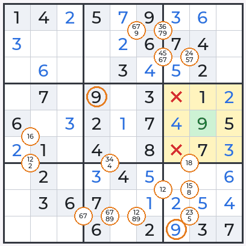

<!-- Written by tools/walkthrough.py quadruple: edit the script, not this page. -->
# Quadruple, step 24: the 9 in box 6

**Step 24 of 51** · [← Step 23](step-23.md) · [All steps](../quadruple.md#the-whole-puzzle-step-by-step) · [Step 25 →](step-25.md)

Box 6 needs a 9. r4c7: row 4 has one (r4c4). r6c7: column 7 has one (r9c7). Only **r5c8** is left: **r5c8 = 9**.

**Step 24 of 51** · [← Step 23](step-23.md) · [All steps](../quadruple.md#the-whole-puzzle-step-by-step) · [Step 25 →](step-25.md)
