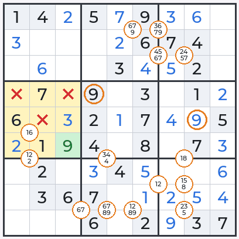

<!-- Written by tools/walkthrough.py quadruple: edit the script, not this page. -->
# Quadruple, step 25: the 9 in box 4

**Step 25 of 51** · [← Step 24](step-24.md) · [All steps](../quadruple.md#the-whole-puzzle-step-by-step) · [Step 26 →](step-26.md)

Box 4 needs a 9. r4c1 and r4c3: row 4 has one (r4c4). r5c2: row 5 has one (r5c8). Only **r6c3** is left: **r6c3 = 9**.

**Step 25 of 51** · [← Step 24](step-24.md) · [All steps](../quadruple.md#the-whole-puzzle-step-by-step) · [Step 26 →](step-26.md)
