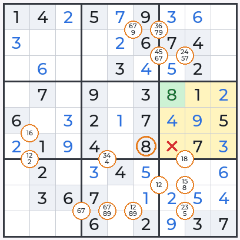

<!-- Written by tools/walkthrough.py quadruple: edit the script, not this page. -->
# Quadruple, step 26: the 8 in box 6

**Step 26 of 51** · [← Step 25](step-25.md) · [All steps](../quadruple.md#the-whole-puzzle-step-by-step) · [Step 27 →](step-27.md)

Box 6 needs an 8. r6c7: row 6 has one (r6c6). Only **r4c7** is left: **r4c7 = 8**.

**Step 26 of 51** · [← Step 25](step-25.md) · [All steps](../quadruple.md#the-whole-puzzle-step-by-step) · [Step 27 →](step-27.md)
