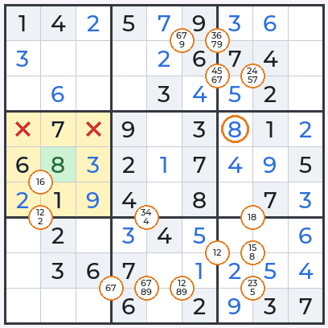

<!-- Written by tools/walkthrough.py quadruple: edit the script, not this page. -->
# Quadruple, step 27: the 8 in box 4

**Step 27 of 51** · [← Step 26](step-26.md) · [All steps](../quadruple.md#the-whole-puzzle-step-by-step) · [Step 28 →](step-28.md)

Box 4 needs an 8. r4c1 and r4c3: row 4 has one (r4c7). Only **r5c2** is left: **r5c2 = 8**.

**Step 27 of 51** · [← Step 26](step-26.md) · [All steps](../quadruple.md#the-whole-puzzle-step-by-step) · [Step 28 →](step-28.md)
