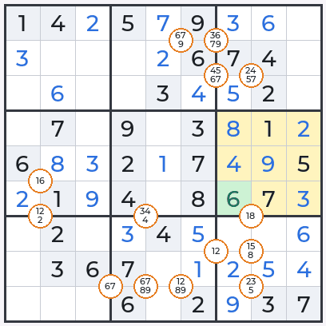

<!-- Written by tools/walkthrough.py quadruple: edit the script, not this page. -->
# Quadruple, step 28: the 6 in box 6

**Step 28 of 51** · [← Step 27](step-27.md) · [All steps](../quadruple.md#the-whole-puzzle-step-by-step) · [Step 29 →](step-29.md)

Box 6 needs a 6, and r6c7 is its last empty cell: **r6c7 = 6**.

**Step 28 of 51** · [← Step 27](step-27.md) · [All steps](../quadruple.md#the-whole-puzzle-step-by-step) · [Step 29 →](step-29.md)
