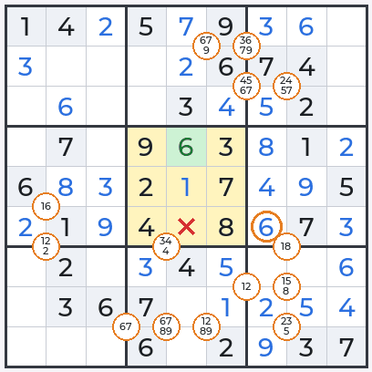

<!-- Written by tools/walkthrough.py quadruple: edit the script, not this page. -->
# Quadruple, step 29: the 6 in box 5

**Step 29 of 51** · [← Step 28](step-28.md) · [All steps](../quadruple.md#the-whole-puzzle-step-by-step) · [Step 30 →](step-30.md)

Box 5 needs a 6. r6c5: row 6 has one (r6c7). Only **r4c5** is left: **r4c5 = 6**.

**Step 29 of 51** · [← Step 28](step-28.md) · [All steps](../quadruple.md#the-whole-puzzle-step-by-step) · [Step 30 →](step-30.md)
