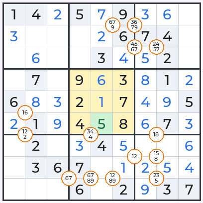

<!-- Written by tools/walkthrough.py quadruple: edit the script, not this page. -->
# Quadruple, step 30: the 5 in box 5

**Step 30 of 51** · [← Step 29](step-29.md) · [All steps](../quadruple.md#the-whole-puzzle-step-by-step) · [Step 31 →](step-31.md)

Box 5 needs a 5, and r6c5 is its last empty cell: **r6c5 = 5**.

**Step 30 of 51** · [← Step 29](step-29.md) · [All steps](../quadruple.md#the-whole-puzzle-step-by-step) · [Step 31 →](step-31.md)
