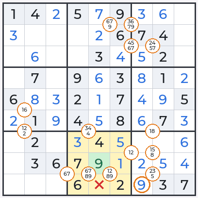

<!-- Written by tools/walkthrough.py quadruple: edit the script, not this page. -->
# Quadruple, step 31: the 9 in box 8

**Step 31 of 51** · [← Step 30](step-30.md) · [All steps](../quadruple.md#the-whole-puzzle-step-by-step) · [Step 32 →](step-32.md)

Box 8 needs a 9. r9c5: row 9 has one (r9c7). Only **r8c5** is left: **r8c5 = 9**.

**Step 31 of 51** · [← Step 30](step-30.md) · [All steps](../quadruple.md#the-whole-puzzle-step-by-step) · [Step 32 →](step-32.md)
