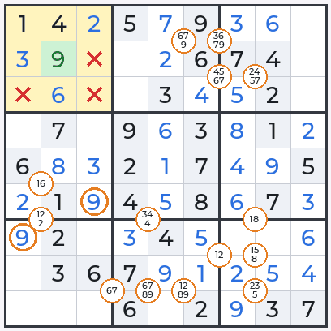

<!-- Written by tools/walkthrough.py quadruple: edit the script, not this page. -->
# Quadruple, step 33: the 9 in box 1

**Step 33 of 51** · [← Step 32](step-32.md) · [All steps](../quadruple.md#the-whole-puzzle-step-by-step) · [Step 34 →](step-34.md)

Box 1 needs a 9. r2c3 and r3c3: column 3 has one (r6c3). r3c1: column 1 has one (r7c1). Only **r2c2** is left: **r2c2 = 9**.

**Step 33 of 51** · [← Step 32](step-32.md) · [All steps](../quadruple.md#the-whole-puzzle-step-by-step) · [Step 34 →](step-34.md)
