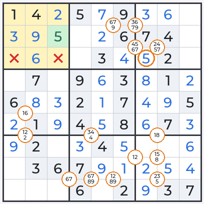

<!-- Written by tools/walkthrough.py quadruple: edit the script, not this page. -->
# Quadruple, step 34: the 5 in box 1

**Step 34 of 51** · [← Step 33](step-33.md) · [All steps](../quadruple.md#the-whole-puzzle-step-by-step) · [Step 35 →](step-35.md)

Box 1 needs a 5. r3c1 and r3c3: row 3 has one (r3c7). Only **r2c3** is left: **r2c3 = 5**.

**Step 34 of 51** · [← Step 33](step-33.md) · [All steps](../quadruple.md#the-whole-puzzle-step-by-step) · [Step 35 →](step-35.md)
