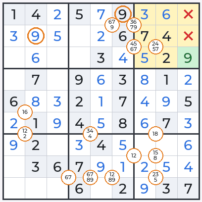

<!-- Written by tools/walkthrough.py quadruple: edit the script, not this page. -->
# Quadruple, step 35: the 9 in box 3

**Step 35 of 51** · [← Step 34](step-34.md) · [All steps](../quadruple.md#the-whole-puzzle-step-by-step) · [Step 36 →](step-36.md)

Box 3 needs a 9. r1c9: row 1 has one (r1c6). r2c9: row 2 has one (r2c2). Only **r3c9** is left: **r3c9 = 9**.

**Step 35 of 51** · [← Step 34](step-34.md) · [All steps](../quadruple.md#the-whole-puzzle-step-by-step) · [Step 36 →](step-36.md)
