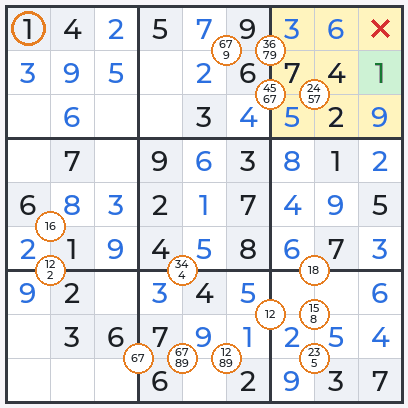

<!-- Written by tools/walkthrough.py quadruple: edit the script, not this page. -->
# Quadruple, step 36: the 1 in box 3

**Step 36 of 51** · [← Step 35](step-35.md) · [All steps](../quadruple.md#the-whole-puzzle-step-by-step) · [Step 37 →](step-37.md)

Box 3 needs a 1. r1c9: row 1 has one (r1c1). Only **r2c9** is left: **r2c9 = 1**.

**Step 36 of 51** · [← Step 35](step-35.md) · [All steps](../quadruple.md#the-whole-puzzle-step-by-step) · [Step 37 →](step-37.md)
