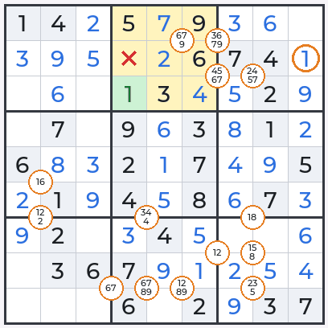

<!-- Written by tools/walkthrough.py quadruple: edit the script, not this page. -->
# Quadruple, step 37: the 1 in box 2

**Step 37 of 51** · [← Step 36](step-36.md) · [All steps](../quadruple.md#the-whole-puzzle-step-by-step) · [Step 38 →](step-38.md)

Box 2 needs a 1. r2c4: row 2 has one (r2c9). Only **r3c4** is left: **r3c4 = 1**.

**Step 37 of 51** · [← Step 36](step-36.md) · [All steps](../quadruple.md#the-whole-puzzle-step-by-step) · [Step 38 →](step-38.md)
