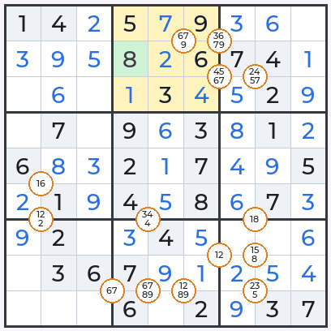

<!-- Written by tools/walkthrough.py quadruple: edit the script, not this page. -->
# Quadruple, step 38: the 8 in box 2

**Step 38 of 51** · [← Step 37](step-37.md) · [All steps](../quadruple.md#the-whole-puzzle-step-by-step) · [Step 39 →](step-39.md)

Box 2 needs an 8, and r2c4 is its last empty cell: **r2c4 = 8**.

**Step 38 of 51** · [← Step 37](step-37.md) · [All steps](../quadruple.md#the-whole-puzzle-step-by-step) · [Step 39 →](step-39.md)
