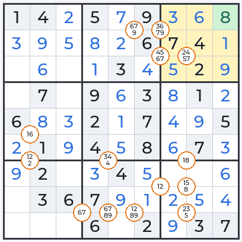

<!-- Written by tools/walkthrough.py quadruple: edit the script, not this page. -->
# Quadruple, step 39: the 8 in box 3

**Step 39 of 51** · [← Step 38](step-38.md) · [All steps](../quadruple.md#the-whole-puzzle-step-by-step) · [Step 40 →](step-40.md)

Box 3 needs an 8, and r1c9 is its last empty cell: **r1c9 = 8**.

**Step 39 of 51** · [← Step 38](step-38.md) · [All steps](../quadruple.md#the-whole-puzzle-step-by-step) · [Step 40 →](step-40.md)
