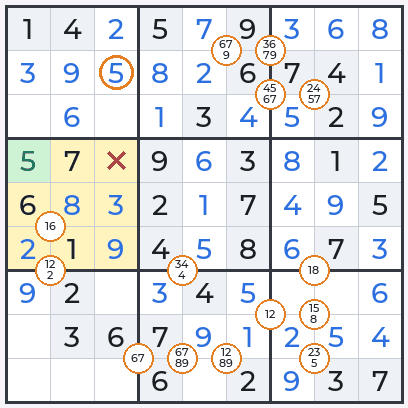

<!-- Written by tools/walkthrough.py quadruple: edit the script, not this page. -->
# Quadruple, step 40: the 5 in box 4

**Step 40 of 51** · [← Step 39](step-39.md) · [All steps](../quadruple.md#the-whole-puzzle-step-by-step) · [Step 41 →](step-41.md)

Box 4 needs a 5. r4c3: column 3 has one (r2c3). Only **r4c1** is left: **r4c1 = 5**.

**Step 40 of 51** · [← Step 39](step-39.md) · [All steps](../quadruple.md#the-whole-puzzle-step-by-step) · [Step 41 →](step-41.md)
