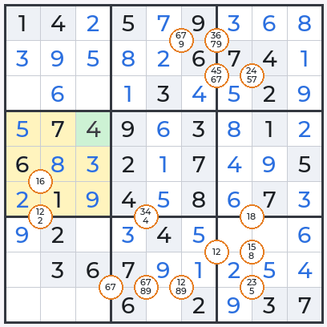

<!-- Written by tools/walkthrough.py quadruple: edit the script, not this page. -->
# Quadruple, step 41: the 4 in box 4

**Step 41 of 51** · [← Step 40](step-40.md) · [All steps](../quadruple.md#the-whole-puzzle-step-by-step) · [Step 42 →](step-42.md)

Box 4 needs a 4, and r4c3 is its last empty cell: **r4c3 = 4**.

**Step 41 of 51** · [← Step 40](step-40.md) · [All steps](../quadruple.md#the-whole-puzzle-step-by-step) · [Step 42 →](step-42.md)
