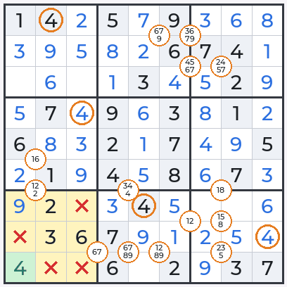

<!-- Written by tools/walkthrough.py quadruple: edit the script, not this page. -->
# Quadruple, step 42: the 4 in box 7

**Step 42 of 51** · [← Step 41](step-41.md) · [All steps](../quadruple.md#the-whole-puzzle-step-by-step) · [Step 43 →](step-43.md)

Box 7 needs a 4. r7c3: row 7 has one (r7c5). r8c1: row 8 has one (r8c9). r9c2: column 2 has one (r1c2). r9c3: column 3 has one (r4c3). Only **r9c1** is left: **r9c1 = 4**.

**Step 42 of 51** · [← Step 41](step-41.md) · [All steps](../quadruple.md#the-whole-puzzle-step-by-step) · [Step 43 →](step-43.md)
