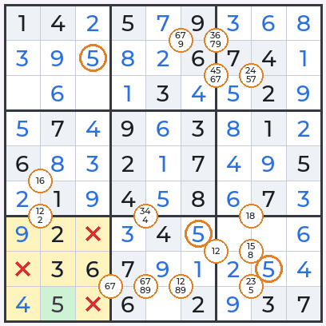

<!-- Written by tools/walkthrough.py quadruple: edit the script, not this page. -->
# Quadruple, step 43: the 5 in box 7

**Step 43 of 51** · [← Step 42](step-42.md) · [All steps](../quadruple.md#the-whole-puzzle-step-by-step) · [Step 44 →](step-44.md)

Box 7 needs a 5. r7c3: row 7 has one (r7c6). r8c1: row 8 has one (r8c8). r9c3: column 3 has one (r2c3). Only **r9c2** is left: **r9c2 = 5**.

**Step 43 of 51** · [← Step 42](step-42.md) · [All steps](../quadruple.md#the-whole-puzzle-step-by-step) · [Step 44 →](step-44.md)
