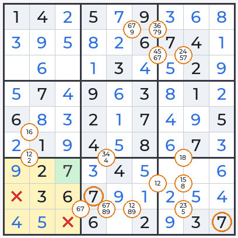

<!-- Written by tools/walkthrough.py quadruple: edit the script, not this page. -->
# Quadruple, step 44: the 7 in box 7

**Step 44 of 51** · [← Step 43](step-43.md) · [All steps](../quadruple.md#the-whole-puzzle-step-by-step) · [Step 45 →](step-45.md)

Box 7 needs a 7. r8c1: row 8 has one (r8c4). r9c3: row 9 has one (r9c9). Only **r7c3** is left: **r7c3 = 7**.

**Step 44 of 51** · [← Step 43](step-43.md) · [All steps](../quadruple.md#the-whole-puzzle-step-by-step) · [Step 45 →](step-45.md)
