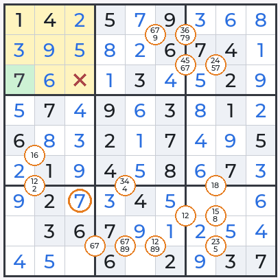

<!-- Written by tools/walkthrough.py quadruple: edit the script, not this page. -->
# Quadruple, step 45: the 7 in box 1

**Step 45 of 51** · [← Step 44](step-44.md) · [All steps](../quadruple.md#the-whole-puzzle-step-by-step) · [Step 46 →](step-46.md)

Box 1 needs a 7. r3c3: column 3 has one (r7c3). Only **r3c1** is left: **r3c1 = 7**.

**Step 45 of 51** · [← Step 44](step-44.md) · [All steps](../quadruple.md#the-whole-puzzle-step-by-step) · [Step 46 →](step-46.md)
