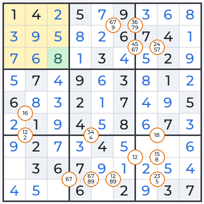

<!-- Written by tools/walkthrough.py quadruple: edit the script, not this page. -->
# Quadruple, step 46: the 8 in box 1

**Step 46 of 51** · [← Step 45](step-45.md) · [All steps](../quadruple.md#the-whole-puzzle-step-by-step) · [Step 47 →](step-47.md)

Box 1 needs an 8, and r3c3 is its last empty cell: **r3c3 = 8**.

**Step 46 of 51** · [← Step 45](step-45.md) · [All steps](../quadruple.md#the-whole-puzzle-step-by-step) · [Step 47 →](step-47.md)
