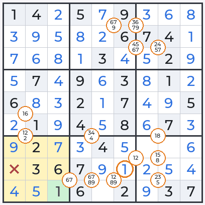

<!-- Written by tools/walkthrough.py quadruple: edit the script, not this page. -->
# Quadruple, step 47: the 1 in box 7

**Step 47 of 51** · [← Step 46](step-46.md) · [All steps](../quadruple.md#the-whole-puzzle-step-by-step) · [Step 48 →](step-48.md)

Box 7 needs a 1. r8c1: row 8 has one (r8c6). Only **r9c3** is left: **r9c3 = 1**.

**Step 47 of 51** · [← Step 46](step-46.md) · [All steps](../quadruple.md#the-whole-puzzle-step-by-step) · [Step 48 →](step-48.md)
