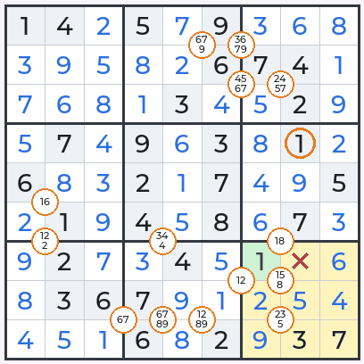

<!-- Written by tools/walkthrough.py quadruple: edit the script, not this page. -->
# Quadruple, step 50: the 1 in box 9

**Step 50 of 51** · [← Step 49](step-49.md) · [All steps](../quadruple.md#the-whole-puzzle-step-by-step) · [Step 51 →](step-51.md)

Box 9 needs a 1. r7c8: column 8 has one (r4c8). Only **r7c7** is left: **r7c7 = 1**.

**Step 50 of 51** · [← Step 49](step-49.md) · [All steps](../quadruple.md#the-whole-puzzle-step-by-step) · [Step 51 →](step-51.md)
