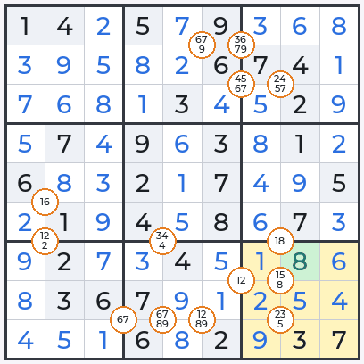

<!-- Written by tools/walkthrough.py quadruple: edit the script, not this page. -->
# Quadruple, step 51: the 8 in box 9

**Step 51 of 51** · [← Step 50](step-50.md) · [All steps](../quadruple.md#the-whole-puzzle-step-by-step) · [All steps](../quadruple.md#the-whole-puzzle-step-by-step)

Box 9 needs an 8, and r7c8 is its last empty cell: **r7c8 = 8**.

Solved.

**Step 51 of 51** · [← Step 50](step-50.md) · [All steps](../quadruple.md#the-whole-puzzle-step-by-step) · [All steps](../quadruple.md#the-whole-puzzle-step-by-step)
